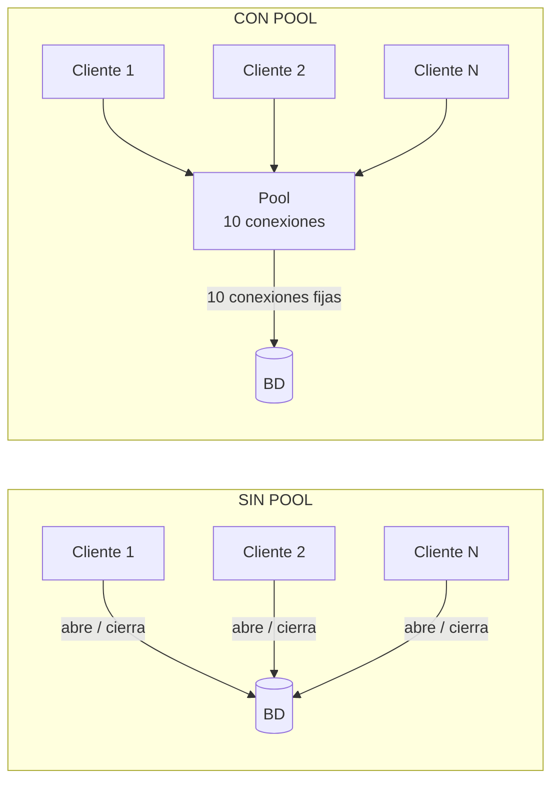
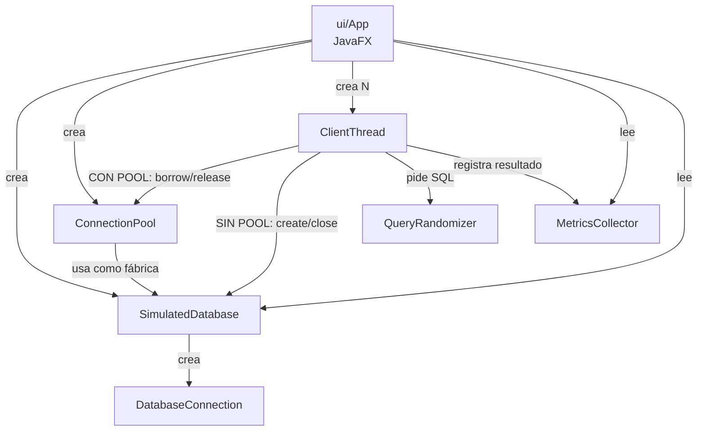
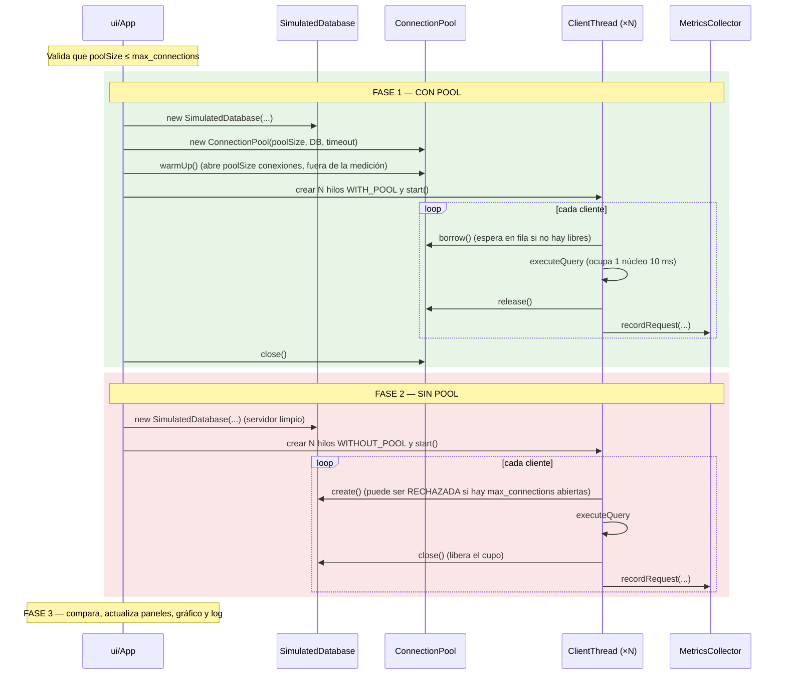

# Explicación completa del Simulador de Pool de Conexiones

Este documento explica **qué hace el programa, cómo está construido, cómo funciona por dentro y
cómo interpretar sus resultados**. Está pensado para estudiar antes de una defensa.

---

## Índice

1. [¿Qué problema resuelve un pool de conexiones?](#1-qué-problema-resuelve-un-pool-de-conexiones)
2. [Teoría: qué debe hacer un buen pool](#2-teoría-qué-debe-hacer-un-buen-pool)
3. [Arquitectura del programa](#3-arquitectura-del-programa)
4. [Las clases, una por una](#4-las-clases-una-por-una)
5. [Flujo completo de una simulación](#5-flujo-completo-de-una-simulación)
6. [Concurrencia: cómo se evita que los hilos se pisen](#6-concurrencia-cómo-se-evita-que-los-hilos-se-pisen)
7. [La interfaz gráfica: parámetros y métricas](#7-la-interfaz-gráfica-parámetros-y-métricas)
8. [Cómo leer los resultados (ejemplo real)](#8-cómo-leer-los-resultados-ejemplo-real)
9. [Qué se corrigió respecto a la versión anterior](#9-qué-se-corrigió-respecto-a-la-versión-anterior)
10. [Cómo ejecutar y probar](#10-cómo-ejecutar-y-probar)
11. [Preguntas típicas de defensa](#11-preguntas-típicas-de-defensa)
12. [Glosario](#12-glosario)

---

## 1. ¿Qué problema resuelve un pool de conexiones?

Cuando un programa quiere hablar con una base de datos necesita una **conexión**. Abrir una
conexión es **caro**:

1. Conexión TCP por la red.
2. Autenticación (usuario/contraseña, en PostgreSQL con hashing SCRAM, que consume CPU).
3. El servidor crea un **proceso nuevo** (backend) para atender a ese cliente.

Ejecutar una query sencilla puede tardar 1–10 ms, pero abrir la conexión puede tardar 20–100 ms.
Si cada petición abre y cierra su propia conexión, **la mayor parte del tiempo se gasta en abrir
conexiones, no en trabajar**.

Además, el servidor tiene un límite: **`max_connections`** (PostgreSQL trae 100 por defecto).
Si llegan más conexiones que ese límite, el servidor las **rechaza** con el error:

```
FATAL: sorry, too many clients already
```

**Un pool de conexiones** es una "caja" que abre unas pocas conexiones al inicio, las mantiene
abiertas y las **presta** a quien las necesite. Cuando el cliente termina, la **devuelve** a la
caja en vez de cerrarla.



---

## 2. Teoría: qué debe hacer un buen pool

| Principio | Qué significa | Cómo lo cumple este programa |
|---|---|---|
| **Reutilizar** | Abrir pocas conexiones y prestarlas muchas veces | `warmUp()` abre `poolSize` conexiones; `borrow()`/`release()` las prestan y devuelven |
| **Limitar** | Nunca abrir más conexiones que el tamaño máximo | `canCreateConnection()` controla `idle + inUse + pendientes < maxSize` |
| **Proteger la BD** | Mantenerse por debajo de `max_connections` | El pool solo abre `poolSize` (la UI impide que sea mayor que `max_connections`) |
| **Esperar, no fallar** | Si no hay conexión libre, el cliente hace fila | `Condition.awaitNanos()` duerme al hilo hasta que alguien devuelva una conexión |
| **Timeout** | No esperar para siempre | Si pasa el timeout, lanza `PoolTimeoutException` (HikariCP usa 30 s por defecto) |
| **Validar** | No prestar conexiones rotas | `pollValidIdleConnection()` revisa `isValid()` y descarta las cerradas |
| **Seguridad entre hilos** | Muchos hilos usan el pool a la vez sin corromperlo | Todo el estado se protege con un `ReentrantLock` |
| **Cierre ordenado** | Al apagar, cerrar conexiones y despertar a los que esperan | `close()` cierra las libres, marca `closed` y hace `signalAll()` |
| **Tamaño pequeño** | Más conexiones que núcleos de CPU no aceleran nada | Fórmula de HikariCP: `conexiones ≈ núcleos × 2 + discos` |

> **La idea central:** con pool, la carga que sobra se convierte en **espera**; sin pool, se
> convierte en **error**.

---

## 3. Arquitectura del programa

```
pool-conexiones/
├── pom.xml                                  Maven: Java 17, JavaFX 21, driver PostgreSQL, JUnit
└── src/main/java/com/proyecto2/
    ├── App.java                             Punto de entrada → lanza ui.App
    ├── pool/
    │   ├── ConnectionPool.java              ★ El pool de conexiones
    │   └── DatabaseConnection.java          Una conexión (simulada o JDBC real)
    ├── database/
    │   ├── SimulatedDatabase.java           ★ Servidor de BD simulado (max_connections + CPU)
    │   ├── DatabaseConfig.java              Lee URL/usuario/clave de PostgreSQL
    │   └── PostgresConnectionFactory.java   Abre conexiones JDBC reales a Sakila
    ├── client/
    │   ├── ClientThread.java                ★ Un cliente (hilo) que hace peticiones con reintentos
    │   ├── ClientSimulationDemo.java        Demo por consola con la BD simulada
    │   └── SakilaSimulationDemo.java        Demo por consola con PostgreSQL real
    ├── query/
    │   └── QueryRandomizer.java             Elige una consulta SQL al azar
    ├── metrics/
    │   └── MetricsCollector.java            Cuenta éxitos, fallos, reintentos y tiempos
    └── ui/
        └── App.java                         Interfaz JavaFX: parámetros, métricas, gráfico, log
```

**Cómo se relacionan:**



La pieza clave del diseño es la interfaz **`ConnectionPool.ConnectionFactory`**:

```java
@FunctionalInterface
public interface ConnectionFactory {
    DatabaseConnection create() throws SQLException;
}
```

Tanto `SimulatedDatabase` como `PostgresConnectionFactory` la implementan. Por eso **el mismo pool
y el mismo cliente** funcionan igual contra la BD simulada o contra PostgreSQL real.

---

## 4. Las clases, una por una

### 4.1 `ConnectionPool` — el pool

**Estado interno** (todo protegido por `lock`):

| Campo | Qué guarda |
|---|---|
| `idleConnections` (`ArrayDeque`) | Conexiones **libres** listas para prestar |
| `connectionsInUse` (`Set` por identidad) | Conexiones **prestadas** ahora mismo |
| `pendingCreations` | Conexiones que se están **creando** en este momento |
| `maxSize` | Tamaño máximo del pool |
| `lock` (`ReentrantLock(true)`) | Candado **justo**: atiende a los hilos en orden de llegada |
| `connectionAvailable` (`Condition`) | "Timbre" para despertar a los hilos que esperan |
| `totalCreated`, `totalBorrowed`, `totalReleased`, `totalTimeouts`, `waitingThreads` | Estadísticas (`PoolStats`) |

**Invariante:** cada conexión está en **exactamente uno** de estos lugares: libre, en uso,
creándose o cerrada. Nunca en dos a la vez.

**Métodos principales:**

#### `warmUp()` — calentar el pool
Abre conexiones hasta llegar a `maxSize` y las deja en `idleConnections`. Se llama **antes** de
iniciar la medición, así el costo de abrir (10 × 50 ms) se paga una sola vez y no se mezcla con
el tiempo de las peticiones.

#### `borrow(timeout)` — pedir prestada una conexión
```text
tomar el candado
repetir:
    si el pool está cerrado → error
    si hay una conexión libre y válida → marcarla "en uso" y devolverla
    si todavía se puede crear una (idle + inUse + pendientes < maxSize):
        reservar el cupo (pendingCreations++)
        SOLTAR el candado, crear la conexión, volver a tomar el candado
        devolverla
    si ya pasó el timeout → PoolTimeoutException
    si no: dormir en connectionAvailable.awaitNanos(lo que queda de tiempo)
soltar el candado
```

Detalle importante: **la conexión se crea fuera del candado** (`createReservedConnection`). Abrir
una conexión tarda 50 ms; si se hiciera con el candado tomado, todos los demás hilos quedarían
bloqueados, incluso los que solo quieren devolver una conexión.

#### `release(conexión)` — devolver una conexión
```text
tomar el candado
si la conexión no estaba "en uso" → error (doble liberación o conexión ajena)
si el pool está cerrado o la conexión está rota → cerrarla
si no → ponerla al final de idleConnections
connectionAvailable.signal()   ← despierta a UN hilo que esté esperando
soltar el candado
```

#### `close()` — cerrar el pool
Marca `closed = true`, cierra todas las conexiones libres y hace `signalAll()` para que los hilos
que esperaban se despierten y reciban el error "pool cerrado". Es **idempotente** (llamarlo dos
veces no rompe nada). Las conexiones prestadas se cierran cuando el cliente las devuelve.

---

### 4.2 `DatabaseConnection` — una conexión

Tiene **dos modos**:

| Modo | Cómo se crea | Qué hace `executeQuery()` |
|---|---|---|
| **JDBC real** | `new DatabaseConnection(jdbcConnection)` | Ejecuta el SQL en PostgreSQL y cuenta las filas |
| **Simulada** | La crea `SimulatedDatabase` | Pide un núcleo de CPU al servidor simulado durante `queryLatency` ms y, opcionalmente, falla al azar |

Otros métodos:
- `isValid()` — en JDBC hace un *ping* (`isValid(2)`); en simulado, `!closed`.
- `close()` — cierra la conexión y ejecuta el gancho `onClose` (lo usa la BD simulada para
  liberar el cupo de `max_connections`).

---

### 4.3 `SimulatedDatabase` — el servidor de BD simulado

Es la pieza que hace que la comparación sea **realista**. Simula un servidor con dos límites, igual
que un PostgreSQL de verdad:

| Límite | Implementación | Efecto |
|---|---|---|
| **`max_connections`** | `AtomicInteger openConnections`; si al incrementar supera el máximo, se lanza `SQLException("too many clients already", "53300")` | Las conexiones de más se **rechazan**, no se encolan |
| **CPU finita** | `Semaphore cpu` con `cpuCores` permisos | Abrir una conexión (50 ms) y ejecutar una query (10 ms) **ocupan un núcleo**. Si hay más trabajo que núcleos, el trabajo espera |

`create()` paso a paso:
1. **Admisión:** `openConnections++`. Si pasa de `max_connections` → rechazo (se cuenta en
   `totalRejected`).
2. **Handshake:** ocupa un núcleo de CPU durante `connectLatency` ms (crear el backend + autenticar).
3. Crea la `DatabaseConnection` y registra `onClose` para hacer `openConnections--` al cerrarla.

Estadísticas que expone: `getTotalOpened()`, `getPeakOpenConnections()`, `getTotalRejected()`,
`getOpenConnections()`.

> Se crea **una instancia nueva por fase** (una para CON POOL y otra para SIN POOL) para que las
> estadísticas no se mezclen.

---

### 4.4 `ClientThread` — un cliente

Es un `Runnable` que se ejecuta en su propio hilo y hace `requestCount` peticiones (en la UI, 1).
Puede trabajar en dos modos:

| Modo | Obtener conexión | Devolver conexión |
|---|---|---|
| `WITH_POOL` | `pool.borrow()` | `pool.release(conexión)` |
| `WITHOUT_POOL` | `factory.create()` (abre una nueva contra la BD) | `conexión.close()` |

**Una petición (`executeRequest`)**:
```text
query = queryRandomizer.getRandomQuery()
inicio = ahora
repetir:
    try:
        conexión = obtener conexión
        conexión.executeQuery(query)
        éxito → salir
    catch SQLException / PoolTimeoutException:
        (rechazo de la BD, fallo de query o timeout del pool)
    finally:
        devolver/cerrar la conexión   ← SIEMPRE, antes de esperar el reintento
    si ya se gastaron los reintentos → salir con fallo
    esperar backoff × númeroDeReintento   (10 ms, 20 ms, ...)
metrics.recordRequest(éxito, ahora - inicio, reintentos)
```

Puntos importantes:
- La conexión se devuelve en un **`finally`**: aunque haya un error, nunca se queda "secuestrada".
- Se devuelve **antes** del backoff, para no retener una conexión mientras se duerme.
- El tiempo medido incluye **todo**: espera en la fila del pool, apertura, query, reintentos y backoff.
- Si el pool se cierra (`IllegalStateException`), el cliente deja de hacer peticiones.

---

### 4.5 `QueryRandomizer` — consultas al azar
Tiene 7 consultas sobre la base **Sakila** (actor, film, customer, rental, payment, joins), todas
con `LIMIT 10` para que el resultado sea pequeño y la medición refleje el costo de
conexión/ejecución, no de transferir datos. `getRandomQuery()` usa `ThreadLocalRandom`, que es
seguro y rápido con muchos hilos.

### 4.6 `MetricsCollector` — métricas
Todos sus métodos son `synchronized` (seguros con muchos hilos).

| Métrica | Cálculo |
|---|---|
| Peticiones totales / exitosas / fallidas | Contadores |
| Reintentos | Suma de reintentos de todas las peticiones |
| Tasa de éxito | `exitosas × 100 / totales` |
| **Tiempo promedio (exitosas)** | Promedio del tiempo **solo de las peticiones exitosas** |
| Tiempo promedio (todas) | Promedio incluyendo las fallidas (solo informativo) |
| **Throughput** | `exitosas × 1000 / tiempoDePared` → peticiones útiles por segundo |

> ¿Por qué el promedio se calcula solo con las exitosas? Porque una petición que la BD rechaza
> falla en ~0 ms. Si se promediara, el modo que **más falla** parecería el **más rápido**.

### 4.7 `DatabaseConfig` y `PostgresConnectionFactory` — PostgreSQL real
`DatabaseConfig.load()` busca la URL, el usuario y la clave en este orden:
1. Propiedades del sistema (`-Dsakila.db.url=...`)
2. Variables de entorno (`SAKILA_DB_URL`, `DB_URL`, `DATABASE_URL`, ...)
3. Archivo `src/main/resources/database.properties` (no se sube a git)
4. Valores por defecto (`localhost:5432/sakila`, usuario `postgres`)

`PostgresConnectionFactory.create()` abre una conexión con `DriverManager.getConnection(...)` y la
envuelve en un `DatabaseConnection` en modo JDBC.

### 4.8 Demos por consola
- **`ClientSimulationDemo`**: compara CON/SIN pool contra la BD simulada. Por defecto 200 clientes y
  pool de 10; acepta argumentos `[clientes] [tamañoPool]`.
- **`SakilaSimulationDemo`**: lo mismo contra PostgreSQL real con Sakila (10 clientes × 20
  peticiones, pool de 5).

---

## 5. Flujo completo de una simulación

Cuando presionas **"Ejecutar simulación"** en la UI:



Toda la simulación corre en un **hilo de fondo** (`simulacion-thread`), y los cambios de pantalla
se hacen con `Platform.runLater(...)`, porque JavaFX solo permite tocar la interfaz desde su propio
hilo. Así la ventana no se congela.

---

## 6. Concurrencia: cómo se evita que los hilos se pisen

| Herramienta | Dónde | Para qué |
|---|---|---|
| `ReentrantLock(true)` | `ConnectionPool` | Exclusión mutua sobre las listas del pool. `true` = **justo** (FIFO) |
| `Condition.awaitNanos()` | `ConnectionPool.borrow` | Dormir sin gastar CPU hasta que haya una conexión libre o venza el timeout |
| `signal()` / `signalAll()` | `release` / `close` | Despertar a uno / a todos los que esperan |
| `while (true)` alrededor de la espera | `borrow` | Al despertar se **vuelve a comprobar** el estado (protege contra despertares espurios y contra otro hilo que se adelantó) |
| `Semaphore` | `SimulatedDatabase` | Limita cuántas operaciones usan la CPU del servidor a la vez |
| `AtomicInteger` / `AtomicLong` | `SimulatedDatabase` | Contadores sin candado (operaciones atómicas) |
| `synchronized` | `MetricsCollector` | Que dos hilos no registren métricas a la vez y se pierda una |
| `volatile` | `closed`, `stopRequested` | Que todos los hilos vean el cambio inmediatamente |

**Problemas clásicos que el diseño evita:**
- **Condición de carrera:** dos hilos tomando la misma conexión libre → imposible, todo pasa bajo el `lock`.
- **Fuga de conexiones:** un cliente falla y no devuelve la conexión → imposible, se devuelve en `finally`.
- **Doble liberación:** devolver dos veces la misma conexión → `release` lanza `IllegalArgumentException`.
- **Inanición:** un hilo que nunca obtiene conexión → el candado justo atiende por orden de llegada, y hay timeout.
- **Bloqueo largo:** crear conexiones con el candado tomado → se crean fuera del candado.

---

## 7. La interfaz gráfica: parámetros y métricas

### Parámetros (panel izquierdo)

| Parámetro | Por defecto | Qué controla |
|---|---|---|
| Tamaño del pool | 10 | Conexiones que el pool abre y reutiliza |
| Timeout de espera (ms) | 30000 | Cuánto espera un cliente una conexión libre antes de fallar |
| Clientes | 20 | Hilos concurrentes (hasta 10.000) |
| Peticiones/cliente | 1 (fijo) | Cada cliente hace una petición |
| Max reintentos | 2 | Intentos extra si una petición falla |
| Backoff (ms) | 10 | Espera antes de reintentar (10 ms, 20 ms, ...) |
| max_connections BD | 100 | Límite de conexiones simultáneas del servidor |
| Núcleos CPU BD | 8 | Operaciones simultáneas que el servidor puede procesar |
| Fallo aleatorio query | 0.0 | Ruido opcional; afecta **igual** a ambos modos |
| Lat. conexión (ms) | 50 | Costo de abrir una conexión (ocupa CPU del servidor) |
| Lat. query (ms) | 10 | Costo de ejecutar una query (ocupa CPU del servidor) |

### Métricas (paneles CON POOL / SIN POOL)

| Métrica | Significado |
|---|---|
| Peticiones totales | Siempre = número de clientes |
| Exitosas / Fallidas | Peticiones que terminaron bien / que agotaron sus intentos |
| Reintentos | Total de intentos extra |
| Tiempo prom. (exitosas) | Latencia promedio de las peticiones que sí funcionaron (incluye espera en fila) |
| Tasa de éxito | % de peticiones exitosas |
| Tiempo total | Tiempo de pared de toda la fase |
| **Conexiones abiertas** | Cuántas conexiones se abrieron contra la BD en toda la fase |
| **Pico simultáneo en BD** | Máximo de conexiones abiertas a la vez / `max_connections` |
| **Rechazos de la BD** | Intentos de conexión rechazados por `max_connections` |

El **log** muestra además el warm-up, los timeouts del pool, el throughput (exitosas/s) y el
porcentaje de mejora.

---

## 8. Cómo leer los resultados (ejemplo real)

Parámetros: **10.000 clientes**, pool 10, `max_connections` 100, 8 núcleos, 50 ms abrir, 10 ms query,
2 reintentos.

| Métrica | CON POOL | SIN POOL |
|---|---|---|
| Exitosas | **10.000** | 400 |
| Fallidas | **0** | 9.600 |
| Reintentos | 0 | 19.492 |
| Tiempo prom. (exitosas) | 5.210 ms | 856 ms |
| Tasa de éxito | **100 %** | 4 % |
| Tiempo total | 14.031 ms | 3.473 ms |
| Conexiones abiertas | **10** | 400 |
| Pico en BD | **10 / 100** | 100 / 100 |
| Rechazos de la BD | **0** | 29.092 |

### SIN POOL — por qué falla el 96 %
- Los 10.000 clientes intentan abrir **su propia** conexión casi a la vez; la BD solo acepta 100
  (**pico 100/100**) y rechaza al resto.
- Las 100 que entran tardan mucho en liberarse: 100 conexiones × 60 ms de CPU / 8 núcleos ≈ **750 ms**
  por tanda. Los reintentos llegan a los 10 y 20 ms: demasiado pronto. Casi todos agotan sus 3
  intentos.
- **Las cuentas cuadran exactamente:**
  - Intentos = 10.000 + 19.492 reintentos = **29.492**
  - Cada intento abrió conexión o fue rechazado: 400 + 29.092 = **29.492** ✓

### CON POOL — por qué funciona el 100 %
- Solo **10 conexiones** en toda la simulación: se abrieron una vez y se reutilizaron 10.000 veces.
- La BD nunca pasó de 10/100 → **0 rechazos**. El pool protegió al servidor.
- Los clientes que no encontraron conexión libre **esperaron en fila**. El último esperó ~14 s, menos
  que el timeout de 30 s → **0 fallos**.

### "¿Por qué el promedio CON POOL (5.210 ms) es más alto?"
1. **No se comparan las mismas peticiones:** con pool se promedian las 10.000 (incluidas las que
   esperaron mucho); sin pool solo las 400 afortunadas.
2. **Es tiempo de cola (Ley de Little):** el servidor puede hacer como máximo 8 núcleos × 100
   queries/s = **800 queries/s**. 10.000 queries necesitan ~12,5 s como mínimo; el promedio de espera
   es cerca de la mitad.
3. El pool trabajó a **10.000 / 14,03 s ≈ 713 queries/s**, casi el 90 % del máximo teórico.

### "¿Por qué el tiempo total SIN POOL es menor?"
Porque **se rindió antes**: la mayoría falló en milisegundos. Lo que importa es el trabajo útil:

| | Exitosas | Tiempo | **Exitosas / segundo** |
|---|---|---|---|
| CON POOL | 10.000 | 14,0 s | **≈ 713** |
| SIN POOL | 400 | 3,5 s | **≈ 115** |

El pool hace **~6 veces más trabajo útil por segundo** y no pierde ninguna petición.

### Con pocos clientes (20, valores por defecto)
No hay rechazos en ninguno de los dos modos (20 < 100), pero sin pool cada petición paga los 50 ms
de apertura. Resultado típico: ~36 ms con pool contra ~167 ms sin pool (**~78 % de mejora**).

---

## 9. Qué se corrigió respecto a la versión anterior

| # | Problema anterior | Consecuencia | Corrección |
|---|---|---|---|
| 1 | El fallo era una moneda al aire del 10 % en cada query, igual en ambos modos | La tasa de fallos salía **igual con y sin pool**: el pool "no servía para nada" | `SimulatedDatabase` con `max_connections` y CPU finita: los fallos ahora tienen una causa real |
| 2 | El modo SIN POOL pasaba por `ConnectionPool.limited()` (un semáforo) | Era **otro pool disfrazado**: encolaba en vez de rechazar | Se eliminó `limited()`; sin pool se conecta directo a la BD |
| 3 | El timeout del pool se inflaba automáticamente hasta 120 s | Ocultaba los timeouts | El timeout es un parámetro (30 s por defecto, como HikariCP) |
| 4 | El tiempo promedio incluía las peticiones fallidas | El modo que más falla parecía más rápido (mejora de −657 %) | Promedio solo de exitosas + throughput |

La clase `ConnectionPool` en sí ya estaba bien construida (candado, condición, timeout, validación,
cierre); el problema estaba en **cómo se simulaba la BD y cómo se medía**.

---

## 10. Cómo ejecutar y probar

Desde la carpeta `pool-conexiones`. Requiere Java 17; Maven no hace falta (se usa `mvnw.cmd`).

**Tests (14, 1 se salta si no hay PostgreSQL):**
```bash
.\mvnw.cmd test
```

**Interfaz gráfica:**
```bash
.\mvnw.cmd javafx:run
```

**Demo por consola (BD simulada), con 1000 clientes y pool de 10:**
```bash
.\mvnw.cmd exec:java -Dexec.mainClass="com.proyecto2.client.ClientSimulationDemo" -Dexec.args="1000 10"
```

**Demo contra PostgreSQL real** (necesita `src/main/resources/database.properties`, ver
`database.properties.example`):
```bash
.\mvnw.cmd exec:java -Dexec.mainClass="com.proyecto2.client.SakilaSimulationDemo"
```

### Qué verifican los tests
- `ConnectionPoolTest` (9): el pool nunca supera `maxSize`, reutiliza conexiones, hace timeout si
  está agotado, rechaza la doble liberación, se cierra bien (incluso dos veces), las estadísticas son
  coherentes y las métricas cuentan bien los reintentos.
- `SimulatedDatabaseTest` (3): la BD rechaza por encima de `max_connections` y libera el cupo al
  cerrar; **con pool** hay 0 rechazos y solo se abren `poolSize` conexiones; **sin pool** y con más
  clientes que `max_connections` aparecen rechazos y fallos.
- `SakilaIntegrationTest` (1): prueba contra PostgreSQL real; se salta si no está disponible.
- `AppTest` (1): test básico.

### Experimentos recomendados
| Experimento | Qué deberías observar | Qué demuestra |
|---|---|---|
| 20 clientes | Ambos 100 % de éxito; con pool mucho más rápido | El costo de abrir conexiones |
| 200 → 1000 → 10.000 clientes | Con pool sigue en 100 %; sin pool la tasa de éxito cae | El pool protege a la BD |
| Timeout 5000 ms con 10.000 clientes | Con pool aparecen fallos por timeout | El timeout evita esperas infinitas |
| Pool 10 → 20 → 50 | El tiempo casi no mejora | El cuello de botella son los núcleos, no las conexiones |
| Núcleos 8 → 16 | Ambos modos mejoran | La capacidad del servidor manda |
| Pool mayor que max_connections | La UI muestra un error y no simula | Un pool nunca debe superar el límite de la BD |

---

## 11. Preguntas típicas de defensa

**¿Qué es un pool de conexiones?**
Un conjunto de conexiones abiertas de antemano que se prestan y se devuelven, para no pagar el
costo de abrir una conexión en cada petición y para limitar cuántas conexiones llegan a la BD.

**¿Qué pasa si todas las conexiones están ocupadas?**
El hilo espera con `awaitNanos` hasta que otro devuelva una (`release` hace `signal`). Si pasa el
timeout, recibe `PoolTimeoutException`.

**¿Por qué usar `while` y no `if` alrededor de la espera?**
Porque al despertar otro hilo pudo haberse llevado la conexión, o el despertar pudo ser espurio.
Hay que volver a comprobar el estado.

**¿Por qué crear la conexión fuera del candado?**
Porque abrir una conexión es lento (50 ms). Con el candado tomado, nadie podría devolver ni pedir
conexiones mientras tanto.

**¿Por qué el candado es justo (`new ReentrantLock(true)`)?**
Para que los hilos se atiendan por orden de llegada y ninguno espere indefinidamente.

**¿Por qué el pool no tiene 1000 conexiones si hay 1000 clientes?**
Porque la BD tiene un límite (`max_connections`) y una CPU finita. Más conexiones que núcleos
solo agregan competencia. La fórmula de HikariCP es `núcleos × 2 + discos`.

**Si el pool es mejor, ¿por qué su tiempo promedio puede ser más alto con 10.000 clientes?**
Porque es tiempo de **espera en fila** de peticiones que sí se atendieron. Sin pool esas peticiones
directamente fallaron. Hay que comparar tasa de éxito y throughput, no solo el promedio.

**¿Qué pasa si una conexión se rompe?**
`borrow` valida con `isValid()` antes de prestarla y descarta las rotas; `release` también cierra
las inválidas en lugar de devolverlas al pool.

**¿Cómo garantizas que no se pierden conexiones?**
El cliente las devuelve en un bloque `finally`, y el pool detecta la doble liberación.

---

## 12. Glosario

| Término | Significado |
|---|---|
| **Conexión** | Canal abierto entre el programa y la BD |
| **Pool** | Conjunto reutilizable de conexiones |
| **Warm-up** | Abrir las conexiones del pool antes de empezar a medir |
| **borrow / release** | Pedir prestada / devolver una conexión al pool |
| **max_connections** | Límite de conexiones simultáneas que acepta el servidor |
| **Timeout** | Tiempo máximo de espera por una conexión |
| **Reintento / backoff** | Volver a intentar tras un fallo / pausa creciente entre intentos |
| **Tiempo de pared** | Tiempo real transcurrido de principio a fin de una fase |
| **Latencia** | Tiempo que tarda una petición individual |
| **Throughput** | Peticiones exitosas por segundo |
| **Ley de Little** | `L = λ × W`: elementos en el sistema = ritmo de llegada × tiempo de estancia; explica por qué la espera crece con la cola |
| **Condición de carrera** | Error que aparece cuando dos hilos modifican lo mismo a la vez |
| **ReentrantLock / Condition** | Candado de Java y su "timbre" para dormir/despertar hilos |
| **Semaphore** | Contador de permisos que limita cuántos hilos hacen algo a la vez |
| **HikariCP** | El pool de conexiones más usado en Java; referencia para los valores por defecto |
