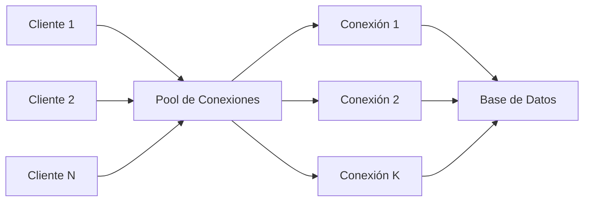
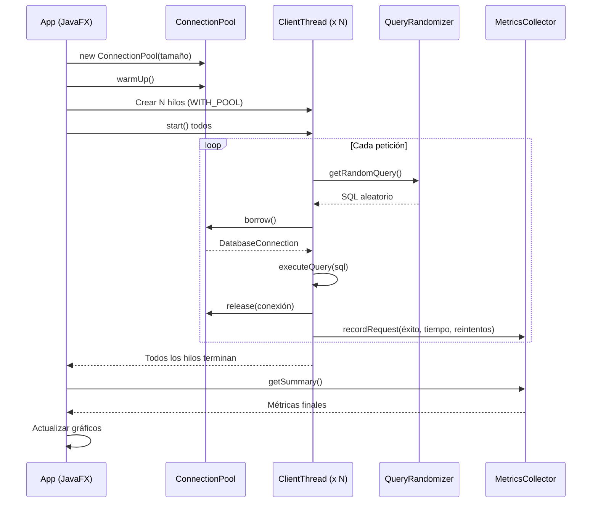

# Simulador de Pool de Conexiones — Guía del Proyecto

## ¿Qué hace este proyecto?

Este proyecto simula un **pool de conexiones a base de datos** y compara su rendimiento contra la estrategia de abrir una conexión nueva por cada petición. Es una herramienta educativa para entender por qué los pools de conexiones son críticos en aplicaciones concurrentes.



---

## Arquitectura del Proyecto

El proyecto está dividido en 3 partes, una por integrante:

### 👤 Integrante 1 — Pool y Conexiones (`pool/` + `client/`)

| Clase | Responsabilidad |
|-------|----------------|
| `ConnectionPool.java` | Administra la cola de conexiones reutilizables. Usa `ReentrantLock` + `Condition` para sincronización. Soporta `borrow()` con timeout, `release()`, `warmUp()` y `close()`. |
| `DatabaseConnection.java` | Representa una conexión. Tiene **dos modos**: simulado (sin BD real, con latencia y tasa de fallo configurable) y JDBC (conexión real a PostgreSQL/Sakila). |
| `ClientThread.java` | Hilo que simula un cliente haciendo N peticiones. Soporta modo `WITH_POOL` (reutiliza conexiones) y `WITHOUT_POOL` (abre una nueva cada vez). Implementa reintentos con backoff. |

### 👤 Integrante 2 — Queries y Métricas (`query/` + `metrics/`)

| Clase | Responsabilidad |
|-------|----------------|
| `QueryRandomizer.java` | Selecciona aleatoriamente una consulta SQL de un conjunto predefinido (consultas contra la BD Sakila con `LIMIT`). |
| `MetricsCollector.java` | Registra de forma thread-safe: total de peticiones, exitosas, fallidas, reintentos, y tiempo de respuesta acumulado. Calcula promedios y tasas. |

### 👤 Integrante 3 — Interfaz Gráfica y Orquestación (`ui/`)

| Clase | Responsabilidad |
|-------|----------------|
| `App.java` (ui) | Aplicación JavaFX que permite configurar parámetros, ejecutar la simulación, y visualizar las métricas con gráficos comparativos en tiempo real. |
| `App.java` (raíz) | Punto de entrada que delega a `com.proyecto2.ui.App`. |

### Clases de soporte (`database/`)

| Clase | Responsabilidad |
|-------|----------------|
| `DatabaseConfig.java` | Lee la configuración de conexión desde propiedades del sistema, variables de entorno, o `database.properties`. |
| `PostgresConnectionFactory.java` | Fábrica que crea conexiones JDBC reales contra PostgreSQL. |

---

## Flujo de la Simulación



---

## ¿Cómo ejecutar el proyecto?

### Requisitos previos
- **Java 17** o superior (ya lo tienes: OpenJDK 17.0.20)
- **No necesitas instalar Maven** — el proyecto incluye Maven Wrapper (`mvnw.cmd`)

### Compilar
```powershell
cd c:\Users\Usuario\Desktop\POOL\pool-conexiones
.\mvnw.cmd compile
```

### Ejecutar los tests
```powershell
.\mvnw.cmd test
```

Deberías ver:
```
Tests run: 11, Failures: 0, Errors: 0, Skipped: 1
BUILD SUCCESS
```
> El test skipped (`SakilaIntegrationTest`) es normal si no tienes PostgreSQL con Sakila configurado.

### Ejecutar la interfaz gráfica (JavaFX)
```powershell
.\mvnw.cmd javafx:run
```

Esto abre la ventana del simulador donde puedes:
1. Configurar los parámetros en el panel izquierdo
2. Presionar **"Ejecutar simulación"**
3. Ver las métricas de **CON POOL** vs **SIN POOL** lado a lado
4. Revisar el gráfico comparativo
5. Leer el log de actividad en tiempo real

### Ejecutar la demo por consola (sin interfaz gráfica)
Si solo quieres ver los resultados en terminal:
```powershell
.\mvnw.cmd exec:java -Dexec.mainClass="com.proyecto2.client.ClientSimulationDemo"
```

### Ejecutar contra PostgreSQL real (opcional)
1. Instala PostgreSQL y carga la base de datos Sakila
2. Crea el archivo `src/main/resources/database.properties`:
   ```properties
   db.url=jdbc:postgresql://localhost:5432/sakila
   db.user=postgres
   db.password=tu_clave
   ```
3. Ejecuta:
   ```powershell
   .\mvnw.cmd exec:java -Dexec.mainClass="com.proyecto2.client.SakilaSimulationDemo"
   ```

---

## ¿Cómo comprobar que funciona?

### ✅ Verificación 1: Tests unitarios
```powershell
.\mvnw.cmd test
```
**Esperado:** `Tests run: 11, Failures: 0, Errors: 0`

Los tests verifican:
- Que el pool **nunca excede** el tamaño máximo de conexiones
- Que las conexiones se **reutilizan** correctamente
- Que `borrow()` lanza **timeout** cuando no hay conexiones disponibles
- Que **no se puede liberar** una conexión dos veces
- Que al cerrar el pool, **no se aceptan** nuevas peticiones
- Que las **métricas** cuentan correctamente éxitos, fallos y reintentos

### ✅ Verificación 2: Demo por consola
```powershell
.\mvnw.cmd exec:java -Dexec.mainClass="com.proyecto2.client.ClientSimulationDemo"
```
**Esperado:** Verás algo como:
```
===== CON POOL =====
Peticiones totales: 1000
Exitosas: ~900
Tiempo promedio: ~X ms

===== SIN POOL =====
Peticiones totales: 1000
Exitosas: ~900
Tiempo promedio: ~Y ms (mayor que X)

Mejora del tiempo promedio usando pool: ~Z%
```
> El tiempo promedio **CON POOL** debe ser significativamente menor porque reutiliza conexiones en vez de abrir una nueva cada vez.

### ✅ Verificación 3: Interfaz gráfica
```powershell
.\mvnw.cmd javafx:run
```
1. La ventana debe abrirse sin errores
2. Presiona **"Ejecutar simulación"** con los valores por defecto
3. Verifica que las métricas se llenan en ambos paneles
4. El gráfico debe mostrar barras comparativas
5. El log debe registrar el inicio, progreso y resultado

---

## Estructura de archivos
```
pool-conexiones/
├── pom.xml                          # Configuración Maven + dependencias
├── mvnw.cmd                         # Maven Wrapper (Windows)
├── .mvn/wrapper/                    # Archivos del Maven Wrapper
├── src/main/java/
│   ├── module-info.java             # Módulo Java (requerido por JavaFX)
│   └── com/proyecto2/
│       ├── App.java                 # Punto de entrada principal
│       ├── pool/
│       │   ├── ConnectionPool.java  # Lógica central del pool
│       │   └── DatabaseConnection.java  # Conexión (simulada o JDBC)
│       ├── client/
│       │   ├── ClientThread.java    # Hilos de clientes concurrentes
│       │   ├── ClientSimulationDemo.java  # Demo consola (simulada)
│       │   └── SakilaSimulationDemo.java  # Demo consola (PostgreSQL)
│       ├── query/
│       │   └── QueryRandomizer.java # Selección aleatoria de queries
│       ├── metrics/
│       │   └── MetricsCollector.java # Recolección de métricas
│       ├── database/
│       │   ├── DatabaseConfig.java  # Configuración de conexión
│       │   └── PostgresConnectionFactory.java  # Fábrica JDBC
│       └── ui/
│           └── App.java             # Interfaz gráfica JavaFX
├── src/main/resources/
│   └── database.properties.example  # Ejemplo de configuración
└── src/test/java/
    └── com/proyecto2/
        ├── AppTest.java             # Test básico
        ├── database/
        │   └── SakilaIntegrationTest.java  # Test de integración
        └── pool/
            └── ConnectionPoolTest.java     # Tests del pool (9 tests)
```

---

## Resumen de lo que aporta cada parte

| Aspecto | Sin Pool | Con Pool |
|---------|----------|----------|
| Apertura de conexiones | 1 por cada intento | Solo al inicio (warm-up) |
| Tiempo promedio | Alto (incluye latencia de apertura) | Bajo (reutiliza) |
| Tiempo total de pared | Mayor | Menor |
| Uso de recursos | Muchas conexiones simultáneas | Limitado al tamaño del pool |
| Concurrencia | Sin control | Controlada con locks |

> **El pool siempre gana** en rendimiento cuando la latencia de apertura es significativa respecto al tiempo de query.

